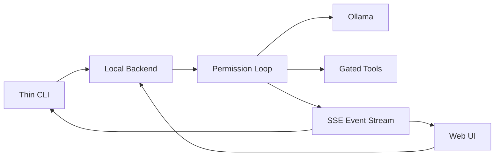

# Latch

A teaching prototype of an agent permission loop:

`observe → propose → permission → act → observe → …`

Inspired by Claude Code’s permission loop — not a replica.

## Architecture



## Run

Needs **Node 20+** and [Ollama](https://ollama.com).

```bash
git clone https://github.com/Kashyab19/Latch.git
cd Latch
npm install
ollama pull llama3.2:3b
npm start
```

Open [http://localhost:8787](http://localhost:8787).

When you’re done:

```bash
npm run stop
```
